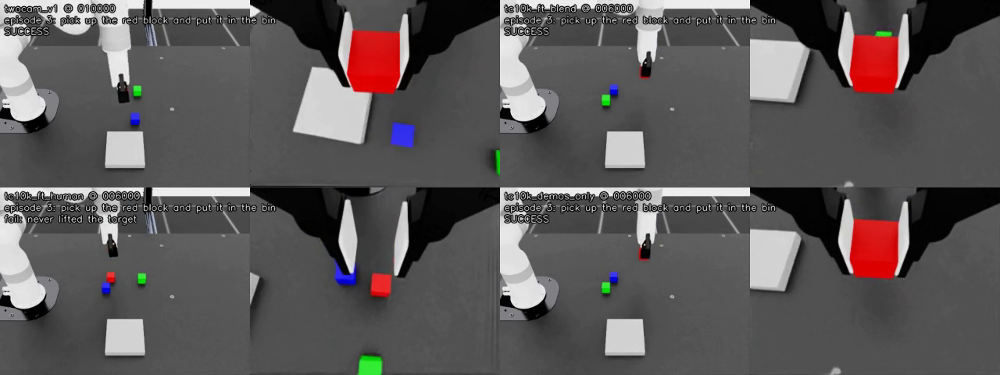

# RandomBlock / SmolVLA — experiment log (two-camera)

Running record of the shared-autonomy study ("Interactive Learning for VLA Shared
Autonomy") on the `two-camera` branch. The single-camera study that came first is
summarised in section 0; its full record (sections 1-13: datasets, configs, every
evaluation, analysis plans) is in `docs/RESULTS.md` on the **`single-camera`** branch.
Section numbers continue from there so cross-references stay valid.

**Task.** `XArm-RandomBlock-*`: three 3 cm blocks (red / green / blue) spawn at
random xy in a 16 x 16 cm square (x 0.29-0.45, y -0.06..0.10); the bin is fixed and
kinematic at (0.37, -0.18), the robot's right. Each episode names one colour —
*"pick up the {colour} block and put it in the bin"* — and the other two are
distractors that must stay out of the bin. Success requires the named block binned
and neither distractor binned. Cameras: gripper-mounted wrist (320x240) and
square-on side (480x360, 44 deg down); no front camera.

**Current base policy:** `outputs/train/twocam_v1/checkpoints/020000/pretrained_model`
(240 demos).

**Evaluation protocol.** `--num_episodes 200 --seed 123 --two_cam --n_action_steps 5
--max_steps 150 --debug_grounding`; every model faces the same 200 layouts, compared
with the paired McNemar exact test. The simulator is not repeatable between runs
(section 17): two runs of one model differ on 70-80 of 200 episodes. Two plain base
runs gave the same total (142, 142); a run through the residual code with a zero
adjustment gave 157, unexplained.

---

## 0. Summary of the single-camera study (full record on `single-camera`)

Original scene: front camera only, bin straight ahead at (0.54, 0), blocks in a
14 x 30 cm rectangle. Not comparable to the two-camera numbers below.

**Base policy.** 100 demos -> 0/20; 250 -> 11/20; 400 (v5 @ 25k) -> **104/200 = 52%**.
More demos past 250 changed nothing; nearly every failure was "never lifted the
target" (a grasp-precision problem, not block selection: 76% grounding).

**Correction rounds** (all finetuned from v5/025000, same 200 episodes):

| Round | alpha | Corrections | D_human (a_H) | D_blend (a_exec) | p (human vs blend) |
|---|---|---|---|---|---|
| 1 (corrections only) | 0.5 | 50 eps | 37.5% | 41.0% | 0.53 |
| 2 (+ 100 base demos) | 0.5 | 50 eps | 49.0% | 44.5% | 0.41 |
| 3 (+ 100 base demos) | 0.5 | 100 eps | 47.5% | 49.0% | 0.83 |
| **3, pre-registered** | **0.8** | **100 eps** | **34.0%** | **53.0%** | **0.00018** |

Base 52.0%; control (`ballast_only`, the same 100 base demos, no corrections) 48.0%.

- **The hypothesis was refuted:** the blended executed action `a_exec` is the better
  label. Raw human actions `a_H` harmed the policy at alpha = 0.8 (vs control
  p = 0.0051) and made no difference at alpha = 0.5, where the two labels are close.
- **No arm improved on the base or the control.**
- Training recipe mattered more than label choice in round 1: corrections-only
  finetuning cost 11-15 points; adding base-demo ballast repaired it.

---

## 14. Two-camera round — analysis plan (written BEFORE the evaluation)

Committed before any evaluation of the two-camera correction arms, so that a later
decision to extend the experiment cannot be mistaken for choosing the sample size that
gave a favourable answer.

**Setting.** New scene and sensors on the `two-camera` branch (formerly `wrist-camera`): a gripper-mounted
wrist camera plus a square-on side camera, no front camera; bin moved to the robot's
right at (0.37, -0.18); square 16 x 16 cm block region. Base policy `twocam_v1/020000`,
240 demos. **Not comparable to the single-camera study** — both the cameras and the
scene differ.

**Collected.** 100 shared-autonomy episodes at alpha = 0.8, 100/100 successful, 7,349
steps of which 1,499 corrective (20%). Mixed with a seeded 50-demo ballast slice the
two arms differ on 1,491 steps = 13.4% of training data, median label gap 11.5 cm —
slightly stronger contrast than the single-camera round that resolved at p = 0.00018
(11.7%, 10.9 cm).

**This round is a PILOT, not the test.** 100 episodes was chosen to get feedback
quickly, not from a power calculation. Its purpose is to confirm the pipeline and
estimate the effect size.

- If an arm wins decisively, that is a result worth reporting, with the caveat that the
  sample size was not pre-specified.
- **If the comparison is null, the pilot's p-value is NOT the answer.** The honest
  response is to collect to a pre-specified N and report that analysis. Reporting a
  null pilot as a finding, or extending and then presenting the combined data as a
  single planned test, would both misstate what was done.

**Secondary.** A control arm (`tc_ballast_only`: the same seeded 50 demos, same recipe,
no corrections, step count matched for equal passes over those demos) is evaluated
alongside, so "does it beat the base" becomes "does it beat finetuning without
corrections".

**Protocol.** 200 episodes, `--seed 123`, `--two_cam`, `--n_action_steps 5`, paired
McNemar exact test — the same protocol as every earlier round, on the new scene.

## 15. Two-camera round — result: the single-camera finding replicates

Run as declared in section 14. Four models, 200 identical episodes (`--seed 123`,
`--two_cam`), paired McNemar exact tests.

**Setup.** Wrist camera (320x240, on the gripper's front face) + square-on side camera
(480x360, 44 deg down); no front camera. Bin at (0.37, -0.18), blocks in a square
16 x 16 cm region (x 0.29-0.45, y -0.06..0.10), spawn rejection 0.12 m from the bin
and 0.05 m from the gripper's start pose. Base: 240 demos (80 layouts x 3 colours),
18,463 frames, 20,000 steps (69 epochs) -> `twocam_v1/020000`. Corrections: 100
episodes at alpha = 0.8 against that checkpoint. Arms: corrections + the same seeded
50-demo ballast, 4,000 steps, lr 2.5e-5, seed 1000. Control: the 50 demos alone, 1,400
steps (23.3 epochs over them, matching the arms).

| Model | Success | Within 1.5 cm | Grounding | Distractor binned |
|---|---|---|---|---|
| `tc_ballast_only` (control) | 146/200 = 73.0% | 160 | 77% | 12 |
| `twocam_v1` (base, 240 demos) | 142/200 = 71.0% | 169 | 83% | 5 |
| `tc_ft_blend` (a_exec) | 141/200 = 70.5% | 164 | 83% | 10 |
| **`tc_ft_human` (a_H)** | **119/200 = 59.5%** | 140 | 72% | 11 |

| Comparison | Discordant | p (exact) |
|---|---|---|
| **a_H vs a_exec** | 40 / 62 | **0.037** |
| a_H vs control | 36 / 63 | **0.0086** |
| a_H vs base | 32 / 55 | **0.018** |
| a_exec vs control | 31 / 36 | 0.63 |
| a_exec vs base | 45 / 46 | 1.00 |
| control vs base | 47 / 43 | 0.75 |

### The same three findings as the single-camera study

1. **Training on the raw human action harms the policy** — 11.5 points below base,
   13.5 below the control, significant against both.
2. **Training on the executed blend is harmless** — indistinguishable from base and
   control.
3. **Corrections do not improve the policy.** No arm beats finetuning without them.

A different scene, a different camera set, a base policy 19 points stronger (71% vs
52%), and a fresh set of corrections give the same ordering. That is the most useful
thing this round shows.

### How much weight it carries

This round was declared a pilot, so its own p = 0.037 is moderate evidence, not a
pre-specified test, and six comparisons were run. Its value is as a **replication** of
the pre-registered single-camera result (section 12, p = 0.00018): same direction, same
arm harmed, same arm harmless, and the two supporting comparisons (a_H vs control, a_H
vs base) agree at p < 0.02. Read together the conclusion is well supported; read alone
this round would not be.

### The mechanism, revised

Section 12 attributed the harm to `a_H` being an out-of-distribution *magnitude*. This
round weakens that account:

| On steps where the labels differ | Single-camera | Two-camera |
|---|---|---|
| Base demos, label travel | 8.7 cm | 11.8 cm |
| `D_human` | 14.1 cm (+62%) | 15.5 cm (+31%) |
| `D_blend` | 3.7 cm (-57%) | 5.1 cm (-57%) |

Here `D_blend` sits *further* from the demo distribution than `D_human` does, yet it is
the harmless one. Magnitude alone therefore does not explain the result. What both
rounds share is **self-consistency**: `a_exec` is by construction the action that
produced the next observation, while `a_H` is a command the robot only 20% followed, so
it is paired with states it never generated. That is the explanation that survives.

### Other observations

- The base reaches 71% here against 52% on the original setup, but the scene is also
  easier (a 40% smaller block region, a closer bin), so the gain cannot be credited to
  the wrist camera alone. The residual failure is unchanged: "never lifted the target".
- Intervention rate was 9% in the first correction session and 13-26% in the other
  nine — the operator calibrating. All 100 episodes were kept; six exceed 50%
  corrective and one runs to 156 steps against a median of 71.
- Base checkpoint `020000` was the final one, chosen without a sweep; `005000`-`015000`
  were never evaluated.
- Each arm is a single training run (seed 1000); training-seed variance is not
  characterised, here or in the single-camera study.

## 16. Residual on a frozen base — analysis plan (written BEFORE any simulator run)

Sections 9-15 finetuned the base on corrections and never beat it. This tries the
alternative: leave `twocam_v1/020000` frozen and learn only the adjustment the
corrections produced, in the style of CR-DAgger. It is position-only residual learning
from SpaceMouse blending, not CR-DAgger itself (no force sensing, no compliant
kinesthetic interface, no force output).

**Data.** The 100 two-camera correction episodes of section 15 (alpha = 0.8), all 7,349
steps. Label per step: `a_exec[:3] - a_R[:3]`, which is exactly zero on the 5,850 steps
without a correction. On the 1,499 corrective steps its norm has median 3.3 cm, p90
4.4 cm, p99 5.1 cm. Orientation is left to the base (executed vs policy orientation
differs by a median of 0.8 deg), and so is the gripper.

**Model.** MLP 3 x 256 on [robot state 14 | base action 8 | base target relative to
fingertip 3], optionally with frozen ImageNet ResNet-18 features of the wrist and side
frames; corrective steps weighted 5x; lr 1e-4, dropout 0.3, weight decay 1e-3. Epoch
count chosen on 20 held-out episodes, then retrained on all 100. `scripts/
residual_extract.py`, `scripts/residual_train.py`, `source/pilot_models/
residual_policy.py`.

**What the offline analysis showed** (held-out episodes; no simulator involved):

| Predictor | Error on held-out corrective steps | Direction cosine |
|---|---|---|
| Predict nothing | 3.26 cm | — |
| One constant vector (the mean correction) | 2.74 cm | +0.49 |
| Images + state + base action (`tc_residual_images`, 8 epochs) | 2.55 cm | +0.55 |
| **State + base action only (`tc_residual_state`, 77 epochs)** | **2.39 cm** | **+0.61** |

- The corrections are mostly one consistent nudge: 89% occur before the grasp with the
  fingertip near the table (median z 2.9 cm), and their mean is (-0.6, -1.4, -1.3) cm —
  down and toward -y. 80% have a negative z component.
- Image features do not help at this data size; they make held-out error worse. The
  state-only network is therefore the configuration selected, even though the original
  design called for images.
- Both networks output ~0.9 cm down near the table and ~0 above 8 cm; the 99th
  percentile of their output is under 4 cm.

**Evaluation (fixed now).** 200 episodes, `--seed 123 --two_cam --n_action_steps 5
--max_steps 150 --debug_grounding`, the same episodes as section 15. Adjustment capped
at 5 cm per step (the p99 of the labels). One run per configuration; nothing is tuned
on simulator results.

- **Sanity:** the residual path with a zero adjustment should reproduce the base's
  142/200. If the simulator is not bitwise repeatable, the number of episodes that flip
  is the run-to-run noise floor and is reported as such.
- **Primary:** base + `tc_residual_state` vs the base (142/200), paired McNemar exact.
- **Secondary:** base + `tc_residual_images` vs the base; each residual vs the control
  (146/200); state vs images.

**Expectation, stated in advance.** The learned adjustment is largely "go about 1 cm
lower at the grasp". If the base's failures are mostly grasps closed too high, this
should convert some of them; if they are lateral misalignments the residual cannot see,
it will not, and it may break grasps that were already succeeding. Either outcome is
reported.

**Not done:** iterating (collecting new corrections with the residual running, then
retraining).

## 17. Residual on a frozen base — result: no effect beyond run-to-run noise

200 episodes each, `--seed 123 --two_cam`, run 2026-10-13 exactly as planned in
section 16. Logs: `docs/eval_logs/eval200_tc_residual_{state,zero,images}.log`.

| Run | Success | Mean adjustment | Never lifted the target | Binned a distractor |
|---|---|---|---|---|
| Base `twocam_v1/020000` (section 15) | 142/200 = 71.0% | — | 53 | 5 |
| **Base + zero adjustment (sanity)** | **157/200 = 78.5%** | 0.00 cm | 33 | 10 |
| Base + `tc_residual_state` (primary) | 151/200 = 75.5% | 0.78 cm, 31% of steps > 1 cm | 42 | 6 |
| Base + `tc_residual_images` | 155/200 = 77.5% | 0.96 cm, 39% of steps > 1 cm | 40 | 5 |
| Control `tc_ballast_only` (section 15) | 146/200 = 73.0% | — | | |

No adjustment ever reached the 5 cm cap.

Paired McNemar exact tests (same 200 episodes):

| Comparison | First only | Second only | p |
|---|---|---|---|
| zero vs base (same model twice) | 47 | 32 | 0.115 |
| **state vs base (primary)** | 41 | 32 | **0.35** |
| images vs base | 42 | 29 | 0.15 |
| state vs control | 40 | 35 | 0.64 |
| images vs control | 42 | 33 | 0.36 |
| state vs zero | 32 | 38 | 0.55 |
| images vs zero | 32 | 34 | 0.90 |
| state vs images | 28 | 32 | 0.70 |

**The sanity check failed, and that is the main finding.** With a zero adjustment the
residual path runs the same frozen base on the same 200 episodes, and nothing it does
reaches the simulator (adding an exact zero to the action; the torch RNG stream is
restored after the network is built). It still disagreed with the original base run
on 79 of 200 episodes and scored 15 episodes higher. The simulator is not repeatable
between runs (GPU physics), so an episode's outcome is close to a coin flip for
roughly 40% of layouts, and two runs of one model can differ by 15/200 (p = 0.115 —
not significant, but large).

Consequences:

- **The primary hypothesis is not supported.** The state residual is not
  distinguishable from the base (p = 0.35), and it scored *below* the zero-adjustment
  run made the same day (151 vs 157). The images residual likewise (155 vs 157).
  Neither residual measurably changes the success rate.
- **The residual does what it learned, just without effect.** It moved the arm a mean
  0.8-1.0 cm, mostly downward (mean vector (-0.3, -0.2, -0.35) cm state, (-0.37, -0.32,
  -0.44) cm images), as the offline analysis predicted. The section 16 expectation —
  "go 1 cm lower at the grasp" converts failed grasps — did not show: "never lifted"
  failures in the residual runs (42, 40) are not lower than in the zero run (33).
- **Pairing is weaker than assumed in sections 12-15.** McNemar remains a valid test
  (it uses only the discordant episodes), but a base re-run alone produces ~80
  discordant episodes, so differences under ~15/200 between single runs should not be
  read as effects. The earlier conclusions survive this: `tc_ft_human` was 23-27
  episodes below every other two-camera arm, and the single-camera round-3 gap was
  19/100 episodes with p = 0.00018. The two-camera base figure itself (142/200) is one
  draw; 142-157 is the range seen for that model.
- Whether all three same-day runs being higher than the earlier ones (151-157 vs
  141-146) is chance or something that changed between sessions is not established. A
  plain base re-run (no `--residual`) would settle it.

**Not done:** iterating the residual (collect corrections with it running, retrain);
more than one run per configuration.

### Addendum: plain base re-run (2026-10-14)

The same base, no `--residual`, same command: **142/200 = 71.0%** — exactly the
first base run's total, though the two disagreed on 72 of 200 episodes (36 each way).
Log: `docs/eval_logs/eval200_tc_base_rerun.log`.

| Run of `twocam_v1/020000` | Residual code | Success |
|---|---|---|
| Base (section 15) | no | 142/200 |
| Base re-run | no | 142/200 |
| Zero adjustment | yes, adds exactly 0 | 157/200 |
| State residual | yes | 151/200 |
| Images residual | yes | 155/200 |

Against the re-run: state p = 0.34, images p = 0.18, zero p = 0.115, control p = 0.73,
`tc_ft_blend` p = 1.0, `tc_ft_human` p = 0.015 (still the one harmful arm). Pooled over
the three runs of the base without a learned adjustment, 441/600 = 73.5%; across them
81 episodes always succeed, 4 always fail and 115 vary.

What this changes:

- **Episode outcomes are noisy, totals less so.** Two plain runs flip ~36% of episodes
  yet land on the same total. Paired tests remain valid; per-episode agreement between
  runs is far weaker than "same seed" suggests.
- **Every run that went through the residual code scored higher** (151-157 vs 142,
  142), the zero-adjustment run most of all. Either that is chance (each comparison
  p = 0.1-0.3) or the residual code path changes something even when it adds nothing.
  This is not resolved; a second zero-adjustment run would distinguish the two.
- **The conclusion about the learned residual stands either way:** neither residual
  scored above the zero-adjustment run (151 and 155 vs 157), so the learned
  adjustment itself adds nothing measurable.

## 18. Weaker base, alpha 0.5 — plan (written BEFORE training or evaluation)

**Goal.** Test whether corrections can *raise* the success rate when the base has
more room to improve, and re-check the label comparison on a weaker base.

**Base.** `twocam_v1/010000` (half of the 20k training run), chosen before it was
evaluated. Its own 200-episode score is measured with the protocol below and is the
reference.

**Corrections.** 100 shared-autonomy episodes at alpha = 0.5 against `010000`
(`logs/rollouts/tc10k_a05_s1..s10`), 100/100 successful, 6,917 steps, 995 corrective
(14%).

**Arms** (each finetuned from `010000`, 6,000 steps, batch 64, lr 2.5e-5 decaying to
2.5e-6, seed 1000; final checkpoint only, no checkpoint selection):

| Arm | Data | Episodes / frames |
|---|---|---|
| `tc10k_ft_blend` | corrections labelled `blend` (a_exec) + all 240 demos | 340 / 25,280 |
| `tc10k_ft_human` | corrections labelled `human` (a_H) + all 240 demos | 340 / 25,280 |
| `tc10k_demos_only` (control) | the 240 demos alone | 240 / 18,463 |

The human and blend sets have identical observations and differ on 988 steps (3.9%),
median label gap 5.7 cm — about a third of the contrast of the alpha = 0.8 round
(13.4%, 11.5 cm). A human-vs-blend difference is therefore not expected to be
detectable here (as at alpha = 0.5 in the single-camera study).

**Evaluation.** 200 episodes, `--seed 123 --two_cam --n_action_steps 5 --max_steps 150
--debug_grounding`, paired McNemar exact.

- **Primary:** best-motivated arm `tc10k_ft_blend` vs the control `tc10k_demos_only`
  (do corrections help beyond the same amount of training on demos?).
- **Secondary:** each arm vs `010000`; `tc10k_ft_human` vs control; human vs blend.
- Two plain runs of one model flip ~70 of 200 episodes (section 17), so a difference
  under ~15/200 is not read as an effect even if a single test crosses p = 0.05.

## 19. Weaker base, alpha 0.5 — result: corrections improve the policy for the first time

Run as planned in section 18 (2026-10-17/18). Logs:
`docs/eval_logs/eval200_{twocam_v1_010000,tc10k_ft_blend,tc10k_ft_human,tc10k_demos_only}.log`.

| Model | Success | Never lifted | Distractor binned | Within 1.5 cm | Grounding |
|---|---|---|---|---|---|
| `twocam_v1/010000` (base) | 136/200 = 68.0% | 57 | 5 | 155 | 80% |
| `tc10k_demos_only` (control) | 135/200 = 67.5% | 59 | 4 | 149 | 80% |
| `tc10k_ft_blend` (a_exec) | 150/200 = 75.0% | 37 | 11 | 154 | 82% |
| **`tc10k_ft_human` (a_H)** | **158/200 = 79.0%** | 38 | 4 | 169 | 76% |
| *for reference: `twocam_v1/020000`, two runs* | *142, 142* | *53, 55* | | | |

Paired McNemar exact (first-only / second-only episodes):

| Comparison | Discordant | p |
|---|---|---|
| **blend vs control (primary)** | 43 / 28 | **0.096** |
| human vs control | 50 / 27 | **0.012** |
| human vs base 010000 | 47 / 25 | **0.013** |
| blend vs base 010000 | 45 / 31 | 0.14 |
| control vs base 010000 | 42 / 43 | 1.00 |
| human vs blend | 40 / 32 | 0.41 |
| human vs base 020000 | 44 / 28 | 0.076 |

**What it shows**

- **Extra training on demos alone does nothing:** the control lands one episode from
  its starting point (135 vs 136). So whatever the correction arms gained came from
  the corrections, not from 6,000 more steps.
- **Both correction arms gained, in the same direction:** blend +15 episodes over the
  control, human +23. The gain is in grasping — "never lifted the target" falls from
  57-59 to 37-38.
- **The pre-registered primary (blend vs control) misses significance (p = 0.096).**
  Human vs control (p = 0.012) is a secondary test; with four secondary comparisons a
  Bonferroni correction puts it at p = 0.047. Its 23-episode gap also exceeds the
  ~15/200 run-to-run noise of section 17, and two plain runs of each base gave
  matching totals (142/142, 136/135 including the control), so the plain-run totals
  are steadier than per-episode flips suggest.
- **The human label is at least as good as the blend here** (158 vs 150, p = 0.41) —
  the opposite ordering from alpha = 0.8, where a_H harmed. Together with section 12
  this is a dose-response: at alpha = 0.5 the two labels are close (3.9% of steps,
  5.7 cm) and a_H does no harm; at alpha = 0.8 they diverge (13.4%, 11.5 cm) and a_H
  hurts.
- The human arm also beats the fully trained `020000` base (158 vs 142, p = 0.076),
  which extra demo training never did.

**What it does not show**

- **"Weaker base" was not the active ingredient:** `010000` scored 68%, barely below
  `020000`'s 71%. This round differs from section 15 (no gain) in several ways at once
  — alpha 0.5 vs 0.8, all 240 demos vs 50 as ballast, 6,000 vs 4,000 steps, a
  different base checkpoint, and an operator with more practice — and the experiment
  cannot say which mattered.
- One training seed per arm; one evaluation run per model.

### Videos

*Episode 3 ("pick up the red block"), same scene for every model — top: base `010000`,
blend; bottom: human, control. Three hold the red block; the human arm closed between
the blue and red blocks ("never lifted the target").*

Recorded with `eval_smolvla.py --video_dir` on the first 10 evaluation episodes
(`--seed 123 --two_cam --debug_grounding`, the evaluation's own flags; README has the
command). Per-model clips are in `logs/videos/<model>/`, 2 x 2 comparisons in
`logs/videos/compare/episode_NN_<colour>.mp4`; the ten comparisons are also in the
repo at [media/videos/](media/videos/) (per-model clips stay local).

- Successes on these 10: base 8, blend 9, human 7, control 9 — the opposite ordering
  from the 200-episode result for the human arm. They illustrate behaviour; the
  200-episode numbers above are the measurement.
- Without `--debug_grounding` the same 10 episodes went 5/10 for the base, with
  identical failures for every model: the flag changes SmolVLA's random-number stream.
  Videos must use the evaluation's exact flags to show comparable runs.

## 20. Next

1. **Confirm section 19 with a second training seed** of `tc10k_ft_human`,
   `tc10k_ft_blend` and `tc10k_demos_only` (`--seed 2000`, same data and recipe):
   about 2.5 h of training and 6 h of evaluation, no teleop. If the gains hold, the
   result no longer rests on one training run.
2. **Second zero-adjustment run** (`--residual ... --residual_zero`, 200 episodes):
   if it again lands well above 142, the residual code path itself changes behaviour
   and should be traced before anything else is built on it.
3. **Training-seed replication** of the `tc_ft_human` / `tc_ft_blend` arms: each is
   one training run, and seed variance is not characterised in either study.
4. **Iterate the residual** (collect corrections with it running, retrain) — the
   DAgger step section 16 left out. Section 17 gives no sign it would help.
5. **Base-checkpoint sweep:** `010000` scored 68% (section 19); `005000` and `015000` were never evaluated.
6. Smaller: sweep `--n_action_steps`; log block positions in `eval_smolvla.py` to
   test whether failures cluster by table position.
